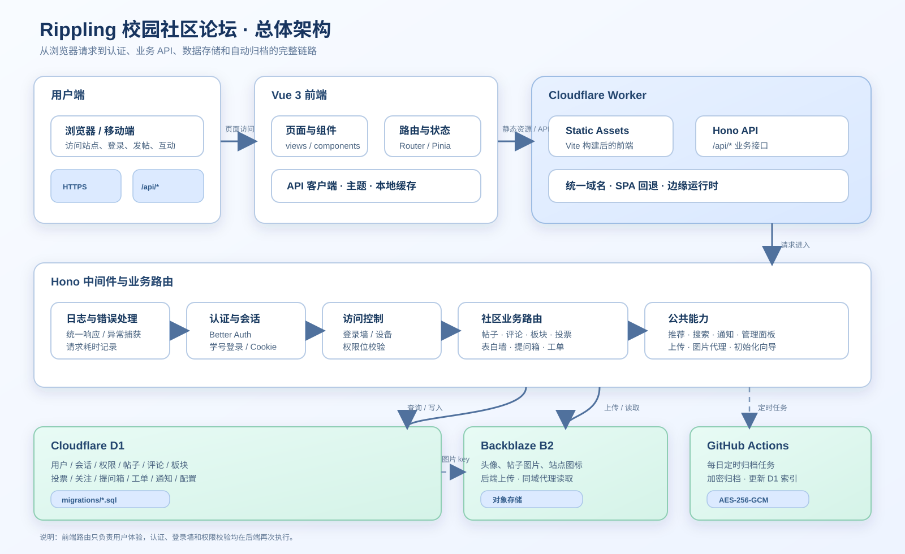

# Rippling 产品实现原理

Rippling 是一个面向校园场景的社区论坛系统。它的核心思路是：使用 Vue 负责交互界面，使用 Hono 提供统一 API，通过 Better Auth 管理登录会话，使用 Cloudflare D1 保存业务数据，再用 Cloudflare Worker + Static Assets 托管整个应用。

## 一、整体结构

```text
浏览器
  │
  ├── Vue 3 页面、路由、状态管理
  │
  └── /api/* 请求
          │
          ▼
    Cloudflare Worker
          │
          ├── Hono API 路由
          ├── Better Auth 认证
          ├── 登录墙、设备、权限、错误处理中间件
          ├── Cloudflare D1 数据库
          └── Backblaze B2 图片存储
```

也可以直接查看下面的高清矢量结构图：



前端和后端使用同一个站点域名，浏览器通过 `/api/` 调用接口，因此不需要额外配置跨域请求。

## 二、前端如何工作

前端代码位于 `src/frontend/`，主要由以下部分组成：

- `views/`：页面，例如首页、帖子详情、登录、管理面板和投票页面。
- `components/`：可复用组件，例如帖子卡片、头像、布局、通知和评论组件。
- `router/`：Vue Router 路由和页面访问控制。
- `stores/`：Pinia 状态，例如当前登录用户、主题和通知状态。
- `api/`：对后端接口的统一调用封装。
- `styles/`：主题变量、颜色、布局和交互样式。

用户打开网站后，前端会通过 `/api/bootstrap` 一次性取得站点配置、初始化状态、当前会话和权限信息，从而减少首屏请求次数。

页面访问由 Vue Router 控制，但真正的安全检查仍然在后端完成。这样即使用户绕过浏览器页面、直接调用 API，也不能绕过服务端权限控制。

## 三、后端如何工作

后端入口是 `src/functions/api/[[route]].ts`，使用 Hono 挂载各个功能模块：

- `/api/post`：帖子和评论
- `/api/like`：点赞
- `/api/confession`：表白墙
- `/api/timeline`：大事记
- `/api/vote`：投票
- `/api/recommend`：推荐流
- `/api/search`：搜索
- `/api/follow`：关注关系
- `/api/question`：提问箱
- `/api/block`：板块管理
- `/api/ticket`：举报、申诉和权限工单
- `/api/admin`：管理员功能
- `/api/upload` 和 `/api/image`：图片上传与读取
- `/api/user`：用户资料和账号设置

每个功能通常由三部分组成：

1. `src/routes/` 中的 HTTP 路由处理请求。
2. `src/db/` 中的数据库函数负责查询和写入 D1。
3. `src/frontend/src/api/` 中的客户端函数负责向页面提供易用的调用方法。

这种分层让页面、接口和数据库逻辑不会全部堆在一个文件里。

## 四、登录和认证原理

项目使用 Better Auth 保存用户、账号和会话信息。

用户看到的是学号登录，但系统内部将学号转换成类似下面的占位邮箱：

```text
20240101 → 20240101@rippling.local
```

这个邮箱只用于满足认证库的格式要求，不用于发送邮件。密码由 Better Auth 负责处理，登录成功后通过安全 Cookie 保存会话。

后端的认证中间件会读取会话，并把当前用户信息放入请求上下文，后续路由可以知道当前用户是谁、是否已登录以及拥有多少权限。

## 五、权限系统原理

Rippling 使用 BigInt 权限位掩码。

每个权限对应一个二进制位，例如：

```text
第 0 位：进入站点
第 1 位：发帖
第 2 位：评论
第 8 位：置顶帖子
```

用户的多个权限可以合并成一个整数。检查权限时，只需要进行位运算即可判断用户是否拥有某项能力。

系统同时存在两类权限：

- 全站权限：发帖、评论、管理用户、访问管理面板等。
- 板块权限：查看板块、管理成员、置顶板块帖子、转让板块等。

管理员、认证用户、普通用户和超级管理员拥有不同的默认权限组合。具体权限定义位于 `src/shared/permissions.ts`。

## 六、登录墙原理

登录墙由站点配置中的 `loginWall` 控制，支持：

- `none`：不限制游客访问。
- `soft`：游客可以查看少量公开内容，但不能浏览完整社区。
- `hard`：游客只能访问登录、注册、初始化等必要接口。

登录墙放在后端中间件中，而不是只放在前端路由中。原因是前端跳转只能限制页面，不能阻止用户直接请求 API。

后端会先检查白名单，再检查当前模式和用户会话，未登录用户会收到统一的 `401 UNAUTHORIZED` 响应。

## 七、数据库设计

项目使用 Cloudflare D1，也就是基于 SQLite 的托管数据库。

数据库迁移文件位于 `migrations/`，主要包含：

- Better Auth 的用户、会话、账号和验证表。
- 用户资料、设备和用户日志表。
- 帖子、评论、点赞和可见性表。
- 表白墙、大事记和投票表。
- 关注、提问箱和提问表。
- 板块、成员、加入申请和黑名单表。
- 工单、通知、管理日志和归档索引表。

通过迁移文件建表的好处是：数据库结构可以跟随代码版本管理，并且可以在不同环境中重复部署。

## 八、推荐流和缓存

推荐流会综合考虑多种因素：

- 点赞数量
- 评论数量
- 关注关系
- 板块关系
- 内容时间
- 随机因素

推荐结果会使用游标分页，避免传统页码分页在新内容插入后产生重复或遗漏。

边缘缓存中间件只缓存明确安全的 GET 请求，例如站点配置、初始化状态、推荐流和图片。按用户变化的推荐流会使用用户会话的哈希值进行分桶，避免把一个用户的结果发给另一个用户。

## 九、图片上传原理

图片不会直接存进 D1，而是上传到 Backblaze B2 对象存储。

流程如下：

1. 浏览器选择图片。
2. 前端在上传前进行压缩和大小控制。
3. 后端检查文件类型和大小。
4. 后端使用 B2 的 S3 兼容接口上传文件。
5. 数据库或页面只保存图片 key 或站内代理地址。
6. 浏览器通过 `/api/image` 读取图片。

这样可以避免数据库保存大量二进制数据，也可以利用对象存储处理图片文件。

## 十、初始化和配置原理

首次访问站点时，前端检查 D1 中是否存在已经初始化的 `site_config` 记录。

如果没有初始化，用户进入 `/setup` 页面。初始化向导会：

1. 创建超级管理员账号。
2. 创建管理员资料和全部权限。
3. 保存站点名称、主题、学号规则和推荐配置。
4. 标记站点为已初始化。

`src/config/site.config.json` 是默认配置。完成初始化后，D1 中的配置优先级更高，管理员可以通过管理面板修改设置，而不需要重新构建前端。

## 十一、归档和数据维护

项目通过 GitHub Actions 定期执行归档脚本。

归档任务会查找超过保留时间的帖子、表白墙内容和大事记，然后：

1. 从 D1 读取记录。
2. 读取相关操作记录。
3. 使用 AES-256-GCM 加密归档内容。
4. 将加密文件写入 `archive/`。
5. 在 D1 中标记原记录已归档。
6. 将归档索引写入数据库。

归档密钥只应该放在 Cloudflare 和 GitHub Secrets 中，不应提交到仓库。

## 十二、部署原理

推荐部署流程是：

```text
GitHub push
    ↓
本地构建 Vue 前端
    ↓
绑定 Cloudflare D1
    ↓
部署 Cloudflare Worker + Static Assets
```

部署配置位于 `wrangler.worker.jsonc`。D1 绑定名称必须是 `DB`，数据库迁移也必须在部署后单独执行。

## 十三、为什么适合学习

这个项目把一个真实 Web 产品常见的组成部分放在了一起：

- 前端组件化和路由管理
- REST 风格 API
- 用户认证与会话
- 全站和板块级权限
- SQLite 数据库建模
- 对象存储
- 缓存和性能优化
- CI/CD 和定时任务
- 数据迁移与归档

因此它既可以作为校园社区的实验项目，也可以作为学习全栈开发、Cloudflare 部署和产品工程化的参考案例。

> 本项目仅供学习参考。如需真实投入使用，请先向学校说明并完成备案。对于使用本项目后可能出现的言论、内容及相关问题，作者概不负责。
